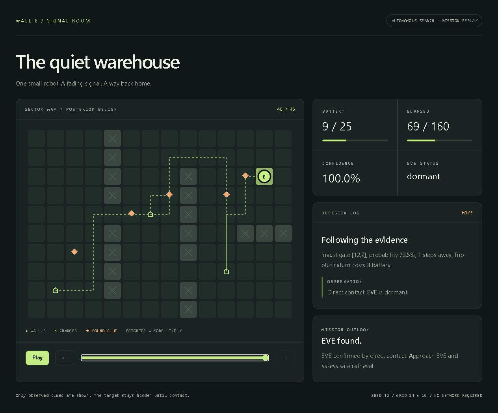

# WALL-E and EVE's Signal

WALL-E has a fading signal, a limited battery, and a warehouse to search. The autonomous agent follows noisy readings, discovers hidden clues, revises its beliefs about EVE, and decides when to scan, recharge, or head back.

This is a complete, deterministic simulation with an offline mission replay. It uses a classical probabilistic planner; no LLM, API key, packages, or network connection is needed to run it.



## First time reading the code?

Think of this as hide-and-seek on a board made of squares. EVE is hidden on one square. WALL-E must find her before his battery or time runs out. He can move, scan for clues, and recharge. He chooses these actions himself.

There are two separate roles: the **world** knows where EVE is, and the **agent** tries to work it out. The world does not hand the answer to the agent. It only gives the readings and clues his actions uncover. WALL-E knows the walls and charger locations from the start; EVE and the clues are hidden.

The code is plain JavaScript. Node.js runs it on your computer. There is no model training or ChatGPT call: the agent uses rules and probability calculations.

```text
walle-eve-signal/
  src/
    cli.js             Starts the program and saves the results
    world.js           The board, hidden EVE, action rules and sensor readings
    agent.js           WALL-E's guesses and decisions
    output.js          Turns the results into a report and a browser replay
  missions/            Settings for three different searches
  examples/            Saved results you can inspect without running anything
  test/                Automatic checks that the program behaves correctly
  .github/workflows/   Tells GitHub to run the checks when code is pushed
  package.json         Defines shortcuts such as npm start and npm test
  README.md            This explanation and the run instructions
```

Here is what happens when you run `npm start`:

1. `cli.js` reads `missions/warehouse.json`. That file describes the board, starting position, battery, costs, hidden EVE and clues.
2. `world.js` creates the world. `agent.js` receives a copy of only the information WALL-E is allowed to know.
3. The `runMission()` function in `agent.js` repeats a small loop: **choose an action → let the world carry it out → read the result → update the guesses**.
4. This continues until EVE is found or no more search trips fit the remaining resources.
5. `cli.js` uses `output.js` to save the action history, final report and replay page.

The main methods to read in `agent.js` are:

| Method | In everyday words |
| --- | --- |
| `constructor()` | Set up WALL-E's memory and initial guesses |
| `updateSignal()` | Make squares more or less likely based on a signal reading |
| `observe()` | Record what just happened and update the guesses |
| `decide()` | Choose whether to move, scan, recharge or stop |
| `summary()` | Give the current best guess and how confident it is |
| `runMission()` | Keep the whole search loop running and build the final report |

For example, a scan might suggest that EVE is roughly five squares to the right. WALL-E raises the chances of nearby squares in that direction. If he checks a square and she is absent, he rules it out. He chooses a promising square he can reach while keeping enough battery and time to get to a charger. Actual contact is needed to confirm he found EVE.

The browser page is a **replay of a completed search**. Play and the slider move through saved actions; they do not send commands to a running agent. To change the search, edit a mission file and run the program again. For example, change `resources.battery` to give WALL-E more or less energy. The mission's `target` value changes where the world hides EVE; the agent still has to discover her.

Suggested reading order: **`missions/warehouse.json` → `src/cli.js` → `runMission()` in `src/agent.js` → `decide()` and `observe()` → `src/world.js`**. Read `src/output.js` last if you want to understand the display. Most of its length is the replay's HTML, CSS and browser controls.

## Run it

Install **Node.js 22 or newer**, then:

```sh
git clone https://github.com/prnvh/walle-eve-signal.git
cd walle-eve-signal
npm start
```

Open `runs/warehouse/replay.html` in any modern browser. Use Play, the timeline slider, or the step buttons to inspect the path, discovered clues, changing probability map, battery, and decision log. The replay is a self-contained HTML file and works directly from disk.

```sh
# Run another mission
node src/cli.js missions/seeded.json --out runs/seeded

# Watch a mission that cannot reach EVE with its battery capacity
node src/cli.js missions/short-battery.json --out runs/short-battery

# Run tests or regenerate the checked-in warehouse example
npm test
npm run demo
```

The CLI exits with code 1 on invalid configuration or execution errors. An inconclusive search is a valid mission outcome and exits with code 0.

## What gets written

| File | Contents |
| --- | --- |
| `mission.public.json` | Mission metadata and initial signal, with hidden target and clue placements omitted |
| `trace.jsonl` | One JSON object per action: previous state, action, decision reason, observation, resources, posterior summary, and full cell probabilities |
| `report.json` | Machine-readable outcome, evidence, inferred location/status, confidence, resource use, and recommended next step |
| `report.md` | Human-readable mission report |
| `replay.html` | Offline interactive map and decision replay |

Checked-in examples live in [`examples/`](examples). The warehouse mission finds dormant EVE at `[12,2]` after **46 actions**, using **69/160 time units**, with **9/25 battery** left. It discovers clues and recharges along the way. The short-battery mission ends **inconclusive**, back at its charger; the seeded mission finds active EVE after **14 actions**.

## Environment

The world is a static 2D grid. Coordinates are `[x,y]`, with `[0,0]` at the top left, positive x to the right and positive y downward. Obstacles, chargers, action costs and the initial signal are public. EVE is stationary. Her location, status, and clue placements are held privately inside `Environment`.

The agent receives only `publicState()` and the observations returned by `step(action)`. It never receives the full mission configuration. Each valid action consumes its configured time and battery; illegal or unaffordable actions throw without mutating the state.

| Action | Observation / effect |
| --- | --- |
| `move` to an adjacent free cell | Updates position; confirms contact if EVE is there, otherwise rules out that cell |
| `scan` | Noisy bearing and range reading; reveals previously unseen clues within Euclidean distance 1.5 |
| `recharge` at a known charger | Restores battery to capacity, consuming recharge time |

Contact is automatic after any successful action, including a scan on EVE's cell. A clue includes its observed position, a noisy coordinate hint about EVE, and a status hint. The simulator makes clue status hints truthful but the agent conservatively treats them as 80% reliable. Clues are discovered once. Sensor errors use seeded Gaussian noise, with bearing in radians and range in grid units. Readings are independent draws; obstacles affect movement, not radio propagation.

## Mission configuration

Missions are JSON; see [`missions/warehouse.json`](missions/warehouse.json) for a complete explicit map and [`missions/seeded.json`](missions/seeded.json) for seeded target/clue placement.

| Field | Meaning |
| --- | --- |
| `name` | Display name (optional) |
| `seed` | Integer from 0 to 4294967295; controls placement and sensor noise |
| `map` | `width`, `height` (integers 2–60), and `obstacles` coordinate array |
| `start` | Free starting coordinate, which must also have a charger |
| `chargers` | Nonempty array of free charger coordinates |
| `target` | Hidden free, reachable EVE coordinate; omit for seeded placement |
| `targetStatus` | Hidden status: `active`, `dormant`, or `damaged` |
| `clues` | Hidden free clue coordinates; omit for seeded placement |
| `clueCount` | Number of generated clues, 0–100; defaults to 4, ignored when `clues` is present |
| `initialSignal` | Optional reading with `origin`, `bearing`, `strength`, and `timestamp`; generated when absent |
| `resources` | Positive `battery`, `time`, `moveCost`, `scanCost`, `moveTime`, `scanTime`, `rechargeTime` |
| `sensor` | Positive `bearingSigma` (radians), `rangeSigma` (grid units) |

`battery` is both initial energy and full charge capacity. `time` is the mission deadline in arbitrary simulation units. An initial signal timestamp is relative to mission start (`0`), so older readings have negative timestamps. Signal strength is in `(0,1]` and maps to estimated distance as `1 / strength - 1`. A supplied initial reading can be misleading: it is evidence, not ground truth.

When `target` is absent, EVE is sampled from reachable free cells other than the start when possible. Generated clues are sampled from reachable cells with replacement, so more than one clue can occupy a cell. An explicit map is always required; the seed generates placement and noise, not terrain. JSON is the supported configuration format; YAML is not implemented.

## How WALL-E decides

1. Start with a uniform location prior over reachable free cells and a uniform prior over the three statuses.
2. Apply the initial bearing/range likelihood. A stale timestamp broadens its noise by `1 + abs(timestamp)/20`.
3. After each observation, multiply cell probabilities by the sensor likelihood, normalize, and exclude a visited cell when there is no contact. Signal updates use log space to preserve numerical stability.
4. A discovered coordinate hint contributes a Gaussian likelihood with a 5% outlier component. Status hints update the categorical status distribution separately. Direct contact sets location and status confidence to 1.
5. Use breadth-first search for paths. Rank candidate cells by `probability / (stepsAway + 1)`, considering only trips whose outward route plus shortest route to a charger fit current battery and remaining time.
6. Refresh the signal after three actions when a search candidate and the return reserve allow it. Otherwise move toward the highest-ranked feasible cell. If no candidate fits, return, recharge when another trip is possible, or stop with an inconclusive report.

The return reserve applies after every action. The agent can use any known charger, including one closer than the starting charger. It does not spend extra battery on a scan if that would remove its route home. A 10,000-action safety limit bounds very large configured missions.

Confidence is the posterior under this simplified model, **not a calibrated probability of mission success**. A sharply peaked belief can still be wrong. The report only calls EVE found after direct contact; clues alone do not establish her location or status. With no informative status evidence, status is reported as `unknown`.

## Project layout

```text
src/world.js     Config validation, seeded randomness, grid paths, hidden environment
src/agent.js     Belief updates, resource-aware action selection, mission execution
src/cli.js       JSON loading and output writing
src/output.js    Markdown report and standalone HTML replay
missions/       Three runnable mission configurations
examples/       Generated traces, reports and replay files
test/           Node's built-in test suite
```

## Verification and limits

`npm test` covers successful contact, recharge decisions, hidden-state isolation, reproducibility, invalid actions/configs, evidence updates, disconnected map regions, low-resource termination, replay script syntax/escaping, and CLI errors. A 30-seed regression checks normalized posteriors, bounded execution, and sufficient battery/time to return to a charger after every action. All 13 tests passed locally on Node 24. GitHub Actions also passed the test suite and sample mission on both Node 22 and Node 24; the active workflow is in [`.github/workflows/test.yml`](.github/workflows/test.yml).

The replay has also been checked in a browser, including timeline navigation and the final contact frame. The planner is a greedy probability-per-distance policy, not an optimal POMDP solver. Walls and charger locations are known; obstacle discovery, moving targets, decoys, multiple agents, and physics simulation are outside this version. The signal model assumes unoccluded radio and fixed Gaussian noise. Large maps serialize a full probability grid per step, so traces and replay files can grow substantially.
